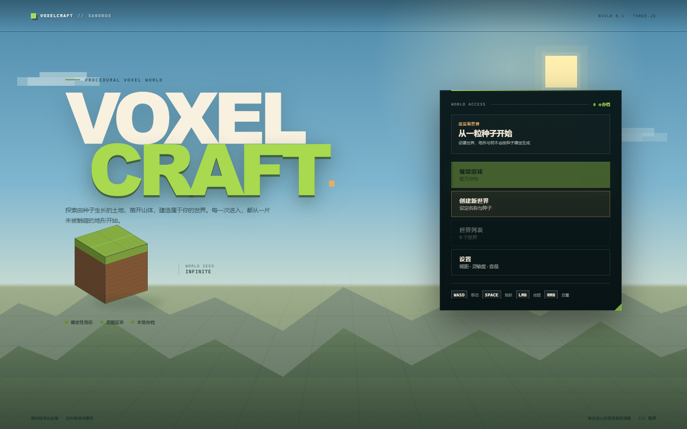
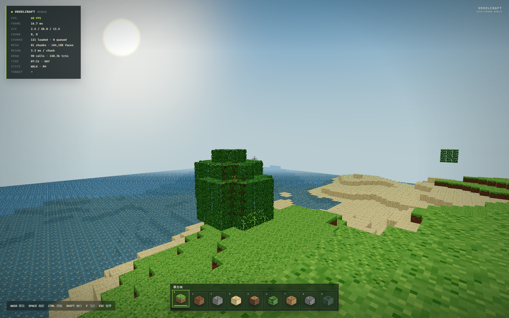
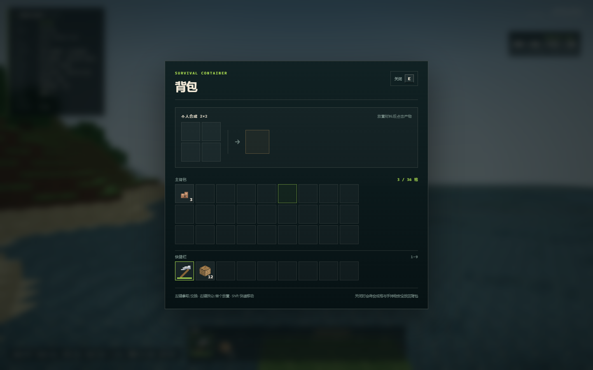
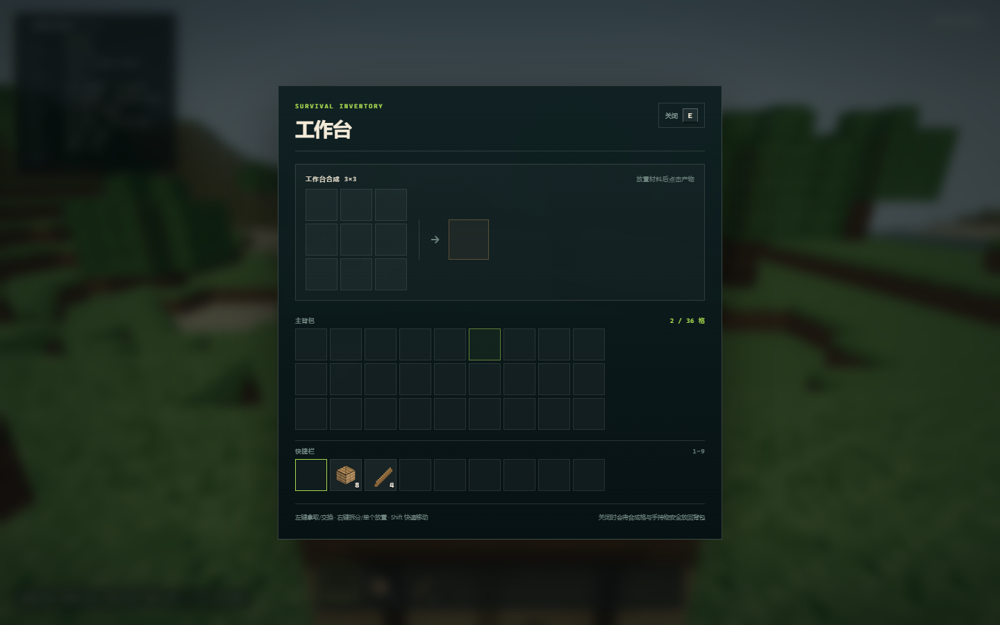
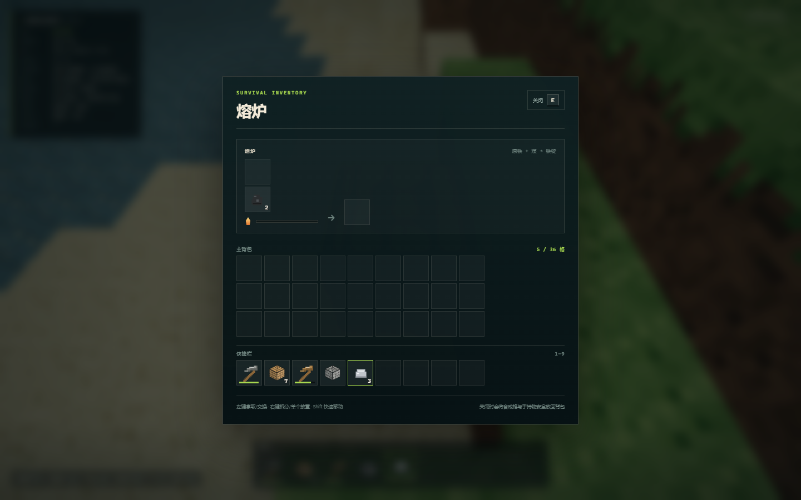

# VoxelCraft V0.2.0

一个从零实现的 Minecraft 风格 3D 体素沙盒。使用 **TypeScript (strict) + Three.js + Vite**，不依赖 React/Vue；所有纹理、图标和音效均为程序化生成，不包含 Minecraft 的受版权保护素材。

V0.2.0 在保留原创造模式与 V0.1 存档的前提下，交付了第一条完整生存闭环：

`橡木原木 → 木板/木棍 → 工作台 → 木镐 → 圆石 → 石镐 + 熔炉 → 煤 + 铁矿石 → 原铁 → 铁锭 → 铁镐`











## 启动

环境要求：Node.js `>= 20.19`（已在 Node 24 / npm 11 验证）。

```bash
npm install
npm run dev        # http://127.0.0.1:5173
```

生产构建与本地预览：

```bash
npm run build
npm run preview
```

### 部署

- Netlify 配置：[netlify.toml](netlify.toml)
- 手动导入、生产冒烟、缓存与 IndexedDB 域名隔离说明：[docs/deployment.md](docs/deployment.md)
- 质量门禁：`npm run check:deploy`（typecheck + 单元测试 + 生产构建）
- 当前状态：Netlify 站点尚未创建；本地生产构建与 `vite preview` 冒烟已通过，线上 URL 待仓库所有者完成 GitHub App 授权后生成。

## 模式

创建世界时可选：

- **生存（默认）**：方块需要挖掘掉落、拾取，工具消耗耐久，放置消耗物品，合成与熔炼需要工作台/熔炉。
- **创造**：无限方块、飞行、即时破坏；沿用 V0.1 的操作方式，并完整兼容旧存档。

难度字段会写入存档。V0.2 尚未实现生命值、饥饿和战斗，因此难度暂不改变玩法。

## 操作

| 输入 | 生存模式 | 创造模式 |
| --- | --- | --- |
| 点击“开始游玩” | Pointer Lock，第一人称 | 同左 |
| `W A S D` | 移动 | 移动 |
| 鼠标 | 观察 | 观察 |
| `Space` | 跳跃 / 水中上浮 | 跳跃 / 上浮 / 飞行上升 |
| `Shift` | 潜行 | 潜行 / 飞行下降 |
| `Ctrl` | 疾跑 | 疾跑 |
| `E` | 打开/关闭背包 | — |
| 左键（按住） | 挖掘；工具等级/速度/耐久生效 | 即时破坏，无掉落 |
| 右键 | 与工作台/熔炉交互，否则放置手持方块 | 放置快捷栏方块 |
| `1`–`9` / 滚轮 | 选择快捷栏 | 选择快捷栏 |
| `F` | — | 切换飞行 |
| `Esc` | 释放鼠标并暂停 | 同左 |

背包内：

- 左键：拿取整叠 / 放下手持堆叠 / 交换；
- 右键：拿取一半 / 单个放下；
- `Shift` + 左键：在快捷栏与主背包间快速移动；
- 合成格放置材料后点击产物；`Shift` 点击产物可批量合成；
- 关闭界面时，合成格和鼠标手持物会安全放回背包；放不下时掉落在脚边。

## 已实现功能

### 生存闭环
- 方块破坏时间由硬度、工具类型、工具等级共同决定；错误工具无法获得石头/矿石掉落。
- 工具等级：手 < 木镐 < 石镐 < 铁镐；铁矿石需要石镐及以上。
- 木镐 60、石镐 132、铁镐 251 点耐久；每次成功破坏消耗 1 点，耗尽后损坏。
- 方块掉落物实体：重力、落地、合并、吸引、拾取延迟、部分拾取；背包满时剩余物品留在世界。
- 36 格玩家背包，快捷栏 0–8；放置方块时原子扣除物品，失败回滚。
- 2×2 个人合成与 3×3 工作台合成；有序/无序配方匹配、材料数量校验、批量合成。
- 熔炉方块实体：输入/燃料/输出槽、燃烧时间、每 10 秒熔炼一个物品、燃料与进度持久化。
- 熔炉被破坏时掉落自身及内容物。

### 方块与物品
- 新增铁矿石、工作台、熔炉、火把；火把使用交叉几何而非立方体。
- 方块、物品、实体分别注册；运行时热路径使用数字 `BlockId`，持久化使用稳定命名 ID（如 `base:oak_log`）。
- 物品图标由同一套程序化像素风格绘制；工具、煤炭、原铁、铁锭、木棍、苹果等非方块物品有独立图标。
- 新世界使用 generator v2（增加地下铁矿）；旧世界保持 generator v1 地形，不重写已有区块。

### 世界、渲染与交互
- 16×16×128 Chunk、确定性噪声地形、树木、洞穴、海洋、煤与铁矿。
- Worker 池生成地形；结果带 `worldId + epoch + sequence` 校验，过期/卸载结果被丢弃。
- 三层 Chunk 网格（不透明/镂空/透明）、AO、面方向明暗、视锥裁剪、雾、天空、日夜循环。
- 1/60 秒固定模拟步长，单帧最多 5 步；超出时间记入调试面板 `SIMDROP`。
- DDA 体素射线拾取、目标高亮、挖掘进度环、粒子与程序化音效。

### 存档
- IndexedDB schema V2：`worlds`、`players`、`chunkDeltas`、`blockEntities`、`entities`、`saveMeta`，保留旧 `chunkEdits`。
- 玩家位置/视角/速度、36 格背包、选中快捷栏、熔炉状态、掉落物实体、方块差异在同一事务中保存。
- V1 存档自动迁移：数字方块 ID → 稳定 ID，补全 `mode='creative'`、`generatorVersion=1`、`difficulty='peaceful'`、`schemaVersion=2`；旧数据不删除。
- 编辑后 1.4 秒防抖保存、15 秒自动保存、暂停/退出强制保存；背包界面打开时暂停自动保存，退出前会关闭界面。

## 架构

```text
src/
  app/
    Game.ts              # 运行时编排：固定步长、交互、存档快照
    GameApp.ts           # 菜单/世界生命周期、Pointer Lock、容器 UI 桥接
    GameLoop.ts          # requestAnimationFrame
    GameEvents.ts        # Game ↔ UI 数据契约
  world/
    World.ts, Chunk.ts, ChunkManager.ts
    WorldGenerator.ts    # generator v1/v2
    BlockRegistry.ts     # 方块属性 + 稳定 ID
  items/
    ItemRegistry.ts      # 物品、工具、燃料、熔炼、方块映射
    ItemStack.ts         # 堆叠、耐久、校验
  inventory/
    Inventory.ts         # 36 格、revision
    InventoryService.ts  # 原子 insert/extract/move/swap/quickMove
    ContainerSession.ts  # 容器 UI 的格子、光标、合成/熔炉操作
  crafting/
    RecipeRegistry.ts, RecipeMatcher.ts, CraftingService.ts
  mining/
    MiningRules.ts, LootTable.ts
  entities/
    ItemEntity.ts, ItemEntityWorld.ts, ItemEntityRenderer.ts
  furnace/
    FurnaceStore.ts
  survival/
    SurvivalState.ts
  player/
    Player.ts, PlayerController.ts, PlayerPhysics.ts, BlockInteraction.ts
  rendering/
    ChunkMesher.ts, ChunkRenderer.ts, TextureAtlas.ts, Materials.ts,
    SkySystem.ts, ParticleSystem.ts
  persistence/
    WorldStorage.ts      # schema V2 + V1 迁移
    SettingsStore.ts
  workers/
    generationWorker.ts, ChunkGenerationService.ts, protocol.ts
  ui/
    UIManager.ts, MainMenu.ts, HUD.ts, Hotbar.ts, ContainerScreen.ts,
    ItemIcon.ts, PauseMenu.ts, SettingsPanel.ts, LoadingScreen.ts,
    WorldCreateDialog.ts, WorldSelectDialog.ts, BlockIcon.ts
tests/
  unit/                  # Vitest：纯逻辑与事务
  e2e/                   # Playwright：真实浏览器闭环
docs/
  adr/                   # 架构决策
  verification/          # 基线、V0.2 验收记录
```

数据流：

1. `GameApp` 通过 `WorldStorage.loadBundle` 一次读取世界、玩家、差异、熔炉和掉落物。
2. `World` 把 `generatorVersion` 与种子交给 Worker；Worker 结果必须匹配世界 ID、epoch 和请求 sequence。
3. 主线程应用玩家方块差异并构建网格。
4. 生存交互通过 `MiningSession` / `LootTable` 计算耗时与掉落，`ItemEntityWorld` 负责掉落与拾取。
5. 背包、合成、熔炉和放置全部通过领域服务做原子变更；UI 只发送命令并渲染快照。
6. 保存时 `Game` 收集差量、背包、熔炉、实体与序号，由 `WorldStorage.saveBundle` 在单个事务中写入。

## 测试与验收

```bash
npm run typecheck   # TypeScript strict
npm test            # 85 个 Vitest 单元测试
npm run build       # tsc + Vite production build
npm run test:e2e    # Playwright，3 个浏览器用例
npm run check:deploy # Netlify 使用的 typecheck + unit + build 门禁
npm run verify      # typecheck + unit + build
```

最新完整结果见 [docs/verification/v0.2.0.md](docs/verification/v0.2.0.md)。

### 自动化覆盖

- **物品/背包**：堆叠上限、插入/提取/移动/交换、快速移动、满背包部分拾取、数量守恒。
- **合成**：2×2/3×3、有序/无序、材料消耗、批量合成、错误工具/材料拒绝。
- **工具/挖掘**：工具等级、挖掘速度、耐久、正确掉落、错误工具无掉落。
- **熔炉**：燃料消耗、熔炼时间、输出容量、破坏掉落、存档往返。
- **掉落物**：合并、重力、吸引、拾取延迟、满包剩余、实体持久化。
- **存档**：V2 单事务写入、V1 三份 fixture 迁移、稳定 ID 转换、熔炉/实体恢复。
- **世界**：generator v1 无铁矿、v2 有铁矿、Worker 过期结果丢弃。
- **E2E**：
  1. 创造世界创建、挖掘、保存、V2 差异读取、退出、继续；
  2. 生存模式使用真实鼠标左键砍树、产生掉落、拾取；
  3. 完整生存闭环：原木→木板/木棍→工作台→木镐→圆石→石镐/熔炉→铁矿/煤→熔炼→铁镐，随后保存/退出/重载并校验数量、方块和熔炉状态。

> 生存闭环 E2E 为缩短约 30 分钟的重复采集，使用仅开发环境可见的测试钩子做确定性传送、直接触发部分资源方块破坏、以及熔炉 tick 加速；挖掘、掉落、拾取、合成、熔炉、存档仍走生产代码路径。真实鼠标砍树与拾取由独立 E2E 覆盖。人工游玩清单见验收记录。

## 浏览器验收脚本

在 `npm run dev`（5173 端口）运行时：

```bash
node scripts/v02-full-loop.mjs   # 完整生存闭环 + 保存/重载，自动输出各阶段数量
node scripts/perf-check.mjs      # 加载时间、FPS、Chunk/Draw Call/网格耗时、堆内存
```

`v02-full-loop.mjs` 与 Playwright 完整闭环用例共用同一套测试钩子，仅用于自动化，不会在正常游戏中暴露。

## 已知限制（V0.2.0）

- 没有生命值、饥饿、坠落伤害、溺水、生物、战斗或死亡重生规则。
- 没有按 `Q` 丢弃物品、拖拽物品、双击收集同类、右键批量放置等高级背包操作。
- 熔炉使用固定煤燃料与铁矿配方；没有通用燃料标签、经验或漏斗。
- 水仍是静态方块；没有熔岩、流体传播。
- 火把不提供光照传播（渲染为自发光十字面）。
- 没有第一人称手持模型/挥动动画，也没有方块裂纹 overlay。
- 没有生物群系、村庄、地牢、多人联机、LOD、Greedy Meshing 或网格 Worker 化。
- 背包界面打开期间自动保存暂停；若浏览器进程被强制终止，界面中尚未放回背包的少量物品可能丢失（正常关闭界面/暂停/退出会先归还）。
- 世界删除 API 已实现但 UI 未暴露；没有导入/导出。
- E2E 的传送/加速仅用于自动化，不代表正常移动速度或熔炉真实等待时间。

## 后续方向

见 [TODO.md](TODO.md)。V0.2 的目标是打通一条可信的生存链，而不是一次性复制 Minecraft 的全部系统。

## 素材与许可

代码与程序化纹理均为本项目原创。没有使用 Minecraft 的任何纹理、模型、音频或代码。第三方依赖为 Three.js、simplex-noise、Vite、Vitest、Playwright 及其许可证。
