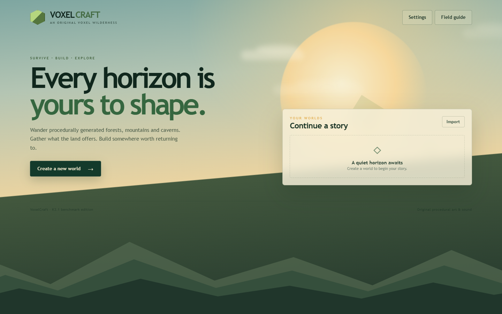

# VoxelCraft — K3.1 Pro

一个从零实现的原创体素沙盒游戏：确定性程序化世界、第一人称挖掘与建造、背包合成、熔炉、生存状态、动物/敌对生物、昼夜循环，以及 IndexedDB 多世界存档。技术栈为 TypeScript、Three.js、Vite、Web Worker、Web Audio、Vitest 与 Playwright。

> 这是针对 `k3.1-pro` 分支的独立实现。项目不包含任何 Minecraft 原版贴图、音乐或资源；纹理、方块图标、生物模型和音效均为程序化原创内容。



## 已实现内容

- 40 种方块、8 种生物群系、洞穴、矿脉、树木、花草、仙人掌、地下遗迹，以及按种子确定性地形。
- Web Worker Chunk 地形生成与 Mesh 构建；按距离加载/卸载、跨块边界修改刷新、面剔除、AO、透明几何分离、视锥裁剪与共享纹理 Atlas。
- 第一人称 WASD、鼠标、跳跃、疾跑、潜行、创造飞行、重力、AABB 碰撞、游泳与溺水。
- DDA 方块射线拾取、目标描边、挖掘裂纹、采集工具等级与耐久、真实掉落物、拾取延迟与合并。
- 9 格快捷栏和 27 格背包，整叠/拆分/快速移动/交换；2×2 随身合成与 3×3 工作台合成，20 条有序/无序配方。
- 熔炉状态（输入/燃料/输出/燃烧/进度）、熔炼配方、熔炉状态持久化。
- 生命、饥饿、氧气、跌落/溺水/生物伤害、死亡掉落、重生。
- 被动与敌对生物、状态机、追击、攻击、击退、掉落物。
- 昼夜天空、太阳、云、阴影、水下滤镜、放置火把的实际点光源。
- 多世界创建/加载/删除/导入导出、自动与手动保存、事务式 IndexedDB、同一世界保存串行化。
- 原创程序纹理、像素图标、几何生物和 Web Audio 程序音效。
- F3 真实性能与世界状态面板。

## 运行

```bash
npm ci
npm run dev
```

生产构建：

```bash
npm run build
npm run preview
```

## 操作

| 输入 | 行为 |
| --- | --- |
| WASD / Mouse | 移动 / 视角 |
| Space | 跳跃；水中上浮；创造模式上升 |
| Ctrl | 疾跑 |
| Shift | 潜行；创造模式下降 |
| 左键 | 挖掘 / 攻击（按住持续挖掘） |
| 右键 | 放置 / 交互 / 进食 |
| E | 打开背包 / 关闭容器 |
| 1–9、滚轮 | 切换快捷栏 |
| Q | 丢弃手上物品 |
| F3 | 调试面板 |
| Esc | 暂停 / 释放鼠标 |

冒烟可玩流程：空手对面前的树按住左键 → 走近拾取原木 → `E` 打开背包 → 原木放入合成格 → 点击右侧成品 → 点击背包空位 → 继续合成木板、木棍与工作台。完整机制见 [docs/gameplay.md](docs/gameplay.md)。

## 质量检查

```bash
npm run typecheck
npm test
npm run build
npm run test:e2e
```

Playwright 使用真实 Chromium、Pointer Lock 和鼠标输入验证：创建世界、移动、砍树、拾取真实掉落物、合成、保存退出、重新加载、双世界隔离。测试结果见 [验收报告](docs/benchmarks/k3.1-pro/acceptance.md)。

## 架构与限制

- [架构说明](docs/architecture.md)
- [游戏规则](docs/gameplay.md)
- [已知限制](docs/benchmarks/k3.1-pro/limitations.md)

当前版本是真实可玩的完整主循环，但不是 Minecraft 全功能等价实现：水流传播、天气、村庄/矿道、红石、护甲、农业生长等仍未实现，详见限制文档。
