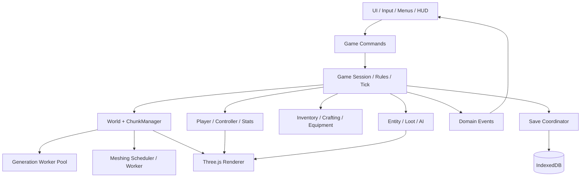
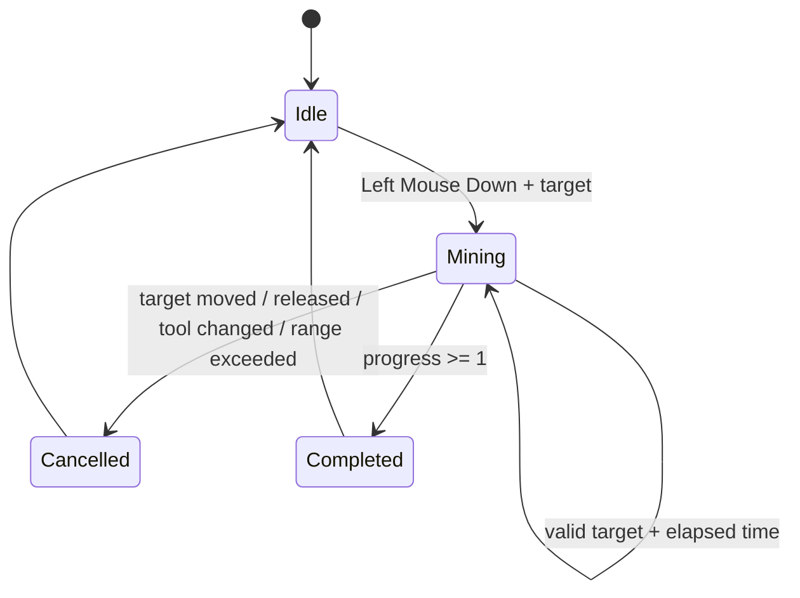
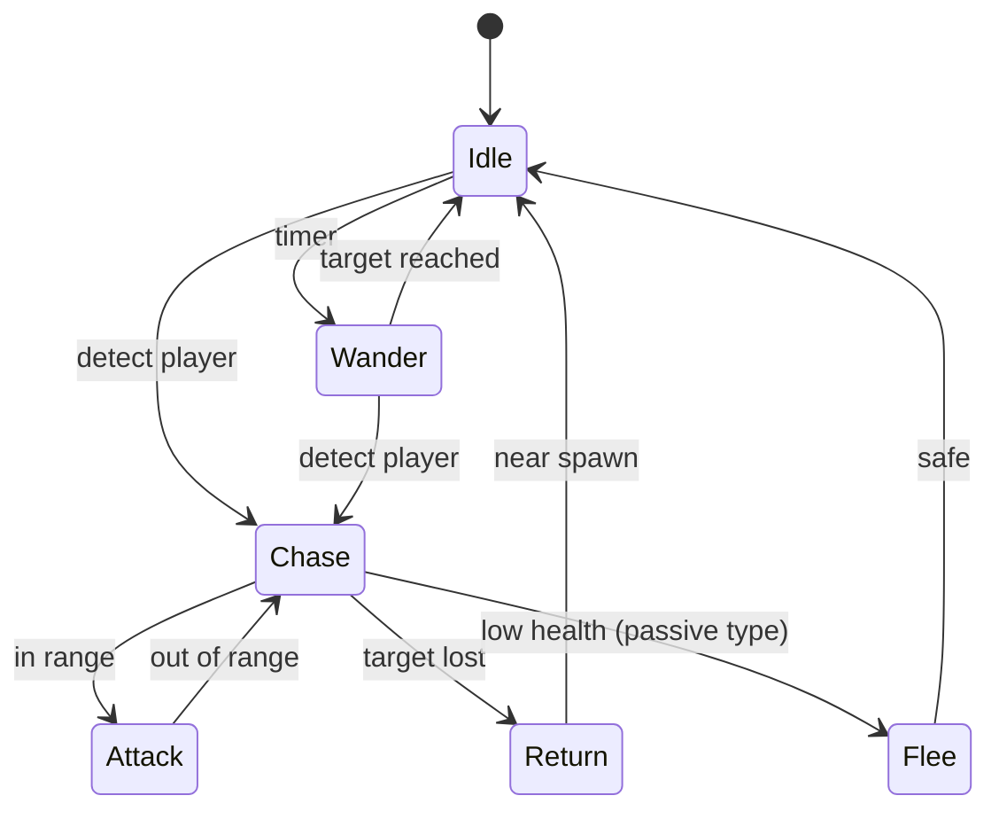

# VoxelCraft 完整产品与技术设计（V0.2 → V1.0）

> **文档版本**：1.0（设计稿）  
> **编写日期**：2026-10-18  
> **当前工程**：`D:\workspace\wodeshijie`（Windows）  
> **定位**：Three.js / TypeScript / Vite 单机网页体素沙盒游戏  
> **基线版本**：V0.1 创造模式 MVP  
> **首要交付**：V0.2 可玩生存闭环  
> **执行对象**：开发者、DS4.1 / DSH / Codex Coding Agent

**信息边界**：本文的“现状”仅依据开发 Agent 提供的 VoxelCraft 交付报告，尚未实地审查仓库源码、运行游戏或复核性能数据。下面所有新设计均为建议目标，不应被误读为已经实现。实施前须以代码与测试核实事实；发生冲突时记录偏差、更新本文，并保留兼容性。

---

## 0. 决策摘要

### 0.1 一句话目标

从“能探索、挖掘和摆放方块的创造模式技术 Demo”，演进成“砍树 → 合成 → 采矿 → 熔炼 → 升级工具 → 活过第一夜”的完整单人生存游戏，同时维持稳定、可扩展、可测的体素引擎。

### 0.2 核心产品决策

1. **先玩法闭环，后性能极限**：V0.2 优先背包、物品、采集、合成、生存；性能项目以消除实际卡顿为前提，而非追逐指标。
2. **两个模式共享一个世界引擎**：创造/生存以规则策略隔离，禁止复制 `World`、`Player`、`ChunkManager`。
3. **Block ≠ Item ≠ Entity**：必须建立独立 ID 空间与数据注册表，统一序列化协议。
4. **固定逻辑步长**：运动/生存/AI 用 fixed timestep，渲染使用 requestAnimationFrame 插值；跨系统操作必须有原子事务或可恢复边界。
5. **保存逻辑以差异为主**：自然生成世界只保存 Seed + Generator Version；保存玩家修改、容器、玩家与动态实体状态，不保存整个已生成地图。
6. **单机先不引入 ECS 框架、后端、多人同步或微服务**：通过有边界的系统和组件化实体模型支持未来扩展。
7. **所有下一阶段功能都有测试与可观察性**：不能仅凭“构建成功”判定“可以玩”。
8. **保留用户既有世界**：从 V0.1 升级后，旧存档必须可加载或得到明确、可恢复的迁移提示。

### 0.3 版本路线

| 版本 | 核心目标 | 对玩家可感知的成果 | 发布门槛 |
|---|---|---|---|
| V0.2.0 | 生存垂直切片 | 砍树→工作台→石镐→铁矿→熔炉→铁镐 | 有完整 20–30 分钟可玩流程 |
| V0.3.0 | 生存内容完善 | 血量/饥饿、昼夜威胁、生物掉落、死亡重生 | 单局连续游戏 1 小时无严重异常 |
| V0.4.0 | 世界与探索 | 生物群系、矿物分层、结构、可探索奖励 | 相同种子生成稳定、旧存档不变形 |
| V0.5.0 | 引擎优化 | 网格 Worker、按需 Greedy Meshing、内存回归 | 高负载下达到约定帧时间指标 |
| V0.6.0 | 流体和玩法扩充 | 水传播、基础农业与更多配方 | 调度、存档、跨 Chunk 行为正确 |
| V1.0.0 | 可发布的单机版本 | 完整菜单、教程、设置、音效、存档可靠性 | 全量回归及正式发布检查通过 |

> 版本顺序为建议路线，可调整；**V0.2 完整闭环优先于所有后续扩展**。

---

## 1. 已有 V0.1 基线与待核查项

### 1.1 已报告实现

- **世界**：16×16×128 Chunk；字符串 Seed；多层噪声；河流、海洋、沙滩、雪顶、洞穴、煤矿、跨 Chunk 树木。
- **渲染**：每 Chunk `BufferGeometry` 合批；六面剔除；顶点 AO；不透明、镂空、透明三套材质；原创纹理 Atlas；视锥剔除；天空与昼夜。
- **调度**：Worker 池负责地形数据生成；距离式加载/卸载；主线程网格预算；边界与对角 Chunk 局部重建。
- **玩家**：Pointer Lock、WASD、跳跃、潜行、疾跑、飞行、水浮力、AABB、有限跨步。
- **交互**：DDA、6 格射程、高亮、按住挖掘、放置碰撞判断、粒子与程序音效。
- **UI/存档**：世界创建、主菜单、HUD、热键栏、IndexedDB 玩家数据与方块差异。
- **工程**：严格 TS、模块化、资源回收、Worker 清理。

### 1.2 已报告验证数据（未独立复测）

| 项目 | 已报告结果 |
|---|---|
| 单测 | 7 个文件、33 个测试通过 |
| E2E | 1 个测试通过，覆盖核心建造/存档路径 |
| Chrome / RTX 3050 / 1440×900 | 视距 4，短时间采样约 59.99 FPS |
| 加载 | 创建世界至 HUD 约 1.41 秒；9×9 网格完成额外约 0.87 秒 |
| 世界状态 | 121 chunks loaded / 81 meshed |
| Draw Calls / Triangles | 100–101 / 约 18–19 万 |
| Mesh | 单 Chunk 网格构建约 3.0 ms |
| JS Heap | 约 59 MB（单点测量） |

**解释**：121/81 可能对应 11×11 数据区与 9×9 网格区，必须通过源码确认。59.99 FPS 可能受 VSync 限制，不能直接得出帧时间余量。

### 1.3 启动前架构审计（P0，强制）

| 检查内容 | 验证要点 | 可接受输出 |
|---|---|---|
| Chunk 坐标系 | 网格顶点为局部坐标、Mesh 原点仅施加一次；负坐标 floorDiv | 回归测试通过 |
| Worker 时序 | generation epoch 与 chunk revision；旧请求能否覆盖新块 | 竞态测试通过 |
| 世界差异保存 | 修改后被卸载/重载、跨版本读取是否稳定 | 集成测试 |
| 内存生命周期 | 卸载纹理、材质、BufferGeometry、EventListener、Worker 的所有权 | dispose 审计结果 |
| 玩家物理 | 重力、碰撞、跨步、水行为的时间步独立性 | 30/60/120 FPS 回归 |
| UI 输入控制 | 键盘事件是否在菜单打开后泄漏到游戏 | UI/E2E 测试 |
| 产物与素材 | 原创贴图及依赖许可、构建资源完整性 | 许可证清单 |

先修阻塞级架构缺陷，再开始叠加生存功能；不要在未知边界上盲目加功能。

---

## 2. 产品设计

### 2.1 玩家故事：第一天

**目标体验长度：20–30 分钟。**

1. 创建世界并选择生存模式；出生在安全的基础地貌，四周有树、石头与可供初期探索的空间。
2. 空手砍树得到原木；打开背包将原木合成木板与木棍。
3. 组合制作工作台；在工作台 3×3 合成木镐。
4. 开采圆石、制作石镐；探索浅层洞穴获取煤和铁矿。
5. 制作熔炉、以煤为燃料熔炼粗铁；制作铁镐。
6. 天色渐暗，玩家需要简单庇护所、食物或光源；保存退出后继续世界。

闭环：**探索 → 采集 → 资源转换 → 工具升级 → 解锁探索深度 → 生存压力 → 下一轮探索**。

### 2.2 模式边界

| 行为 | 创造模式 | 生存模式 |
|---|---|---|
| 放置方块 | 无库存消耗 | 消耗物品，失败不扣库存 |
| 挖掘 | 即时 | 随方块硬度和工具推进 |
| 背包 | 可选物品面板/无限材料 | 有限格数、堆叠与耐久 |
| 生命值/饥饿 | 不参与规则 | 启用 |
| 掉落物 | 可选关闭 | 生成、拾取、存档 |
| 飞行 F | 默认允许 | 默认禁止，可配置开发调试 |
| 死亡 | 无 | 物品按游戏规则掉落/保留 |
| 合成 | 非必要 | 核心进程 |

模式创建后默认不可切换（防止误破坏平衡）；需要调试时提供显式开发开关并对世界标记 `cheatsEnabled`。已有 V0.1 世界缺省按 `creative` 加载，不得被强制转为生存。

### 2.3 V0.2 非目标

正式排除：多人联机、红石、电路、村民经济、复杂路径规划、程序化建筑群、附魔、末地/地狱、大地图同步、商业化支付、账号体系、完整游戏生态。以后版本也只在有明确需求时扩展。

---

## 3. 总体架构

### 3.1 分层与依赖方向



**约束**：`World` 只负责方块读写与空间事务；UI 不直接修改 Chunk；Three.js 对象不进入存档数据结构；Worker 不直接访问 DOM / WebGL；持久化不依赖渲染对象。

### 3.2 推荐目录（增量重构而非覆盖）

```text
src/
  app/                   # Game, GameLoop, GameSession, Lifecycle
  core/                  # Clock, EventBus, Registry, RNG, Types
  world/                 # World, Chunk, ChunkManager, WorldGenerator
    biome/               # BiomeRegistry, TerrainLayers, FeaturePlanner
    generation/          # GeneratorVersion, Ores, Structures
  blocks/                # BlockRegistry, BlockDefinition, BlockBehavior
  items/                 # ItemRegistry, ItemDefinition, ItemStack
  inventory/             # Inventory, InventoryTransaction, Equipment
  crafting/              # RecipeRegistry, RecipeMatcher, CraftingService
  mining/                # MiningService, LootTable, ToolRules
  furnace/               # FurnaceBlockEntity, SmeltingService
  player/                # PlayerStats, Controller, Physics, Interactor
  survival/              # HungerSystem, DamageSystem, RespawnSystem
  entities/              # EntityWorld, EntityDefinition, ItemEntity
    ai/                  # BehaviorStateMachine, Navigation, SpawnSystem
  fluids/                # FluidScheduler, FluidRules（后续）
  rendering/             # ChunkMesher, Materials, EntityRenderer, Sky
  workers/               # WorldGenWorker, MeshWorker（后续）
  persistence/           # WorldStorage, Schema, SaveCoordinator, Migrations
  ui/                    # HUD, InventoryScreen, CraftingScreen, Menus
  telemetry/             # Metrics, DiagnosticOverlay
  assets/                # textures, audio（如存在）
tests/
  unit/
  integration/
  e2e/
  fixtures/
  performance/
docs/
  adr/
  spec/
```

### 3.3 核心运行时

- **Simulation**：固定 `1/60s` 逻辑 Tick；帧间累积 `accumulator`，单帧最大补偿 5 个 Tick，额外时间截断并记录 `simulationDroppedMs`。
- **Rendering**：`requestAnimationFrame`，用插值 alpha 渲染实体 Transform；相机平滑不可反向修改物理状态。
- **Background**：世界生成、序列化、网格计算等可通过 Worker 分工；所有结果经过 revision 校验。
- **UI**：统一只读状态快照和显式 Action，禁止组件直接修改库存数组/ChunkBuffer。
- **暂停**：单机暂停冻结世界逻辑 Tick 与生存计时；存档任务可继续完成，渲染/UI 保持工作。

```ts
interface GameClock {
  fixedStepSeconds: number; // 1 / 60
  accumulatorSeconds: number;
  tickIndex: number;
  paused: boolean;
}

interface WorldContext {
  worldId: string;
  seed: string;
  generatorVersion: number;
  mode: 'creative' | 'survival';
  difficulty: 'peaceful' | 'normal';
  timeOfDayTicks: number;
}
```

### 3.4 命令和事件

写命令以业务粒度表述，禁止 UI 同时自己改状态又调 World API：

```ts
type GameCommand =
  | { type: 'mine.begin'; block: BlockPos }
  | { type: 'mine.cancel' }
  | { type: 'block.place'; pos: BlockPos; hotbarSlot: number }
  | { type: 'inventory.move'; from: SlotRef; to: SlotRef; quantity?: number }
  | { type: 'craft.take'; recipeId: string; repetitions: number }
  | { type: 'furnace.take'; pos: BlockPos; quantity: number }
  | { type: 'player.useItem'; slot: number };

type DomainEvent =
  | { type: 'block.changed'; pos: BlockPos; oldId: BlockId; newId: BlockId }
  | { type: 'inventory.changed'; inventoryId: string; revision: number }
  | { type: 'item.spawned'; entityId: string }
  | { type: 'player.damaged'; amount: number; cause: string }
  | { type: 'player.died'; worldId: string }
  | { type: 'world.saveRequested'; reason: string };
```

**事务语义**：库存消耗与方块放置、配方材料扣除与结果产出必须一次操作校验后提交；若中途失败不得“方块放上了、物品未扣”或“材料扣了、道具没给”。单线程世界事务用命令队列和版本检查实现，不需要数据库式分布式事务。

---

## 4. 方块、物品与数据驱动注册体系

### 4.1 ID 规则

建议使用命名空间字符串作为对外稳定 ID（例如 `base:oak_log`），运行时可映射为紧凑整数索引；**存档禁止直接依赖可重新排序的数组下标**。

```ts
type BlockId = string & { readonly __blockId: unique symbol };
type ItemId = string & { readonly __itemId: unique symbol };
type EntityTypeId = string & { readonly __entityType: unique symbol };

type MaterialTag =
  | 'wood' | 'stone' | 'soil' | 'ore'
  | 'plant' | 'liquid' | 'metal';

interface BlockDefinition {
  id: BlockId;
  displayName: string;
  hardness: number;       // 0 = instant, Infinity = unbreakable
  requiredTool?: 'pickaxe' | 'axe' | 'shovel';
  minimumToolTier?: 0 | 1 | 2 | 3;
  harvestableByHand: boolean;
  solid: boolean;
  transparent: boolean;
  replaceable: boolean;
  textureKey: string;
  lootTableId?: string;
  blockEntityType?: string;
  tags: readonly MaterialTag[];
}

interface ItemDefinition {
  id: ItemId;
  displayName: string;
  maxStack: number;       // 1 for non-stackable tools
  iconKey: string;
  placeBlockId?: BlockId;
  tool?: { kind: 'axe' | 'pickaxe' | 'shovel'; tier: 1 | 2 | 3; speed: number };
  maxDurability?: number;
  food?: { hunger: number; saturation: number };
  tags: readonly string[];
}
```

### 4.2 注册表契约

- 所有 ID 唯一；启动校验方块贴图、掉落表、配方、工具、熔炼引用均存在。
- 资产丢失显示可诊断占位方块，但**不得静默把未知 ID 改为空气并写回存档**。
- `BlockDefinition` 描述世界行为，`ItemDefinition` 描述持有/使用行为；如 `base:stone` 方块与 `base:cobblestone` 物品可不同。
- 引擎系统不认识特殊“石镐编号 7”等魔法常量，只根据工具标签、属性和注册表处理。
- JSON 数据可按需要拆文件，但首次实现可用 TypeScript 常量数据，保持静态类型校验。

### 4.3 首批方块/物品

| 分类 | 最小集合 |
|---|---|
| 地形 | grass_block、dirt、stone、sand、snow、water、bedrock |
| 木材 | oak_log、oak_leaves、oak_planks |
| 矿物 | coal_ore、iron_ore、coal、raw_iron、iron_ingot |
| 建筑 | crafting_table、furnace、cobblestone、torch |
| 中间材料 | stick |
| 工具 | wooden_pickaxe、stone_pickaxe、iron_pickaxe；木/石斧可后补 |
| 食物 | apple、cooked_food（首版可用少量自然掉落） |

注意规范化原有方块 ID 时务必建立迁移映射，避免老世界变成未知方块。

---

## 5. 物品、掉落与背包系统（V0.2-P1）

### 5.1 数据模型

```ts
interface ItemStack {
  itemId: ItemId;
  count: number; // 1 <= count <= item.maxStack
  durability?: number; // 仅耐久物品，1..maxDurability
  meta?: Record<string, string | number | boolean>;
}

interface Inventory {
  id: string;
  revision: number;
  slots: Array<ItemStack | null>;
}

type SlotRef = { inventoryId: string; slot: number };

interface InventoryMoveResult {
  ok: boolean;
  reason?: 'invalid_slot' | 'incompatible' | 'inventory_changed' | 'not_enough';
  movedCount: number;
}
```

**容量**：生存背包 36 格（0–8 快捷栏、9–35 主背包）；创造成品面板单独显示，不纳入持久化生存库存。

**堆叠**：一般材料 64；工具 1；含耐久或特殊 `meta` 的堆叠必须属性完全一致。空槽 `null`，不使用 count=0 的幽灵条目。

### 5.2 事务操作

```ts
interface InventoryService {
  canInsert(inv: Inventory, stack: ItemStack): number;
  insert(inv: Inventory, stack: ItemStack): { accepted: number; remainder: number };
  extract(inv: Inventory, slot: number, quantity: number): ItemStack | null;
  move(from: SlotRef, to: SlotRef, quantity?: number): InventoryMoveResult;
  split(slot: SlotRef, amount: number): InventoryMoveResult;
  swap(a: SlotRef, b: SlotRef): InventoryMoveResult;
  tryConsume(recipe: readonly Ingredient[]): boolean;
}
```

规则：单次命令先复制受影响槽或创建操作计划，校验版本、容量、堆叠、材料，再一次提交并增 `revision`；失败则状态零改变。

### 5.3 掉落世界实体

- 方块销毁执行 `LootTable`，生成 `ItemEntity`，每个实体有 `id, itemStack, position, velocity, bornTick, pickupDelay`。
- 生成时轻微抛物速度和重力；碰撞后落地；限定 0.5 秒拾取延迟；玩家 1.5 格内可吸附、0.6 格内拾取。
- 拾取使用 `InventoryService.insert`，仅销毁被成功纳入库存的数量；背包满则剩余数量留在世界。
- 同类同元数据掉落按数量上限合并，避免大量小实体造成 draw calls / GC 压力。
- 掉落过期（例如 5 分钟）可清理，但世界暂停时不过期；卸载区动态实体应持久化或显式设计清理策略，**不能无声丢失玩家物品**。
- 创造模式默认可禁止自然掉落。

### 5.4 背包交互

- `E` 打开背包，鼠标捕获恢复；`Esc` 关闭。
- 左键拿起/放下/交换整堆；右键放下一个；Shift+左键快速移动到另一容器。
- 物品跟随鼠标显示，离开窗口或暂停时必须安全归位，防止“鼠标持有状态”丢失。
- UI 显示堆叠数量、工具耐久条；键盘 `1–9` 切换快捷栏。
- 基础无障碍：按钮可聚焦、Tooltip 显示物品名称、禁用与错误状态可见。

### 5.5 验收

- 物品拆分、合并、满背包、非法槽、跨容器移动均覆盖单元测试。
- 破坏 20 个方块 → 拾取 → 快捷栏 → 放置 → 退出重进，数量守恒。
- 视野内生成 100 件掉落物，帧时间不出现严重长尾；有实际测量而非只写结论。

---

## 6. 采集、工具与掉落规则（V0.2-P2）

### 6.1 挖掘状态机



`MiningSession` 持有 `{targetPos, targetBlockId, startedTick, progress, toolSlot, toolFingerprint}`；每个逻辑 Tick 检查目标是否仍存在、是否在 6 格视距内、游戏是否暂停、工具是否变更、权限是否允许。

### 6.2 采集效率

推荐先采用简单可测试的统一模型，而不必机械复制 Minecraft 公式：

```ts
// 仅作设计定义；实现时数字集中配置，不得散落于系统内部
const progressPerSecond = block.hardness <= 0
  ? Infinity
  : effectiveMiningSpeed(tool, block) / (1.5 * block.hardness);
```

- 空手基础采集速度 `1`；正确工具：木 `2`、石 `4`、铁 `6`。
- 错误工具：速度回退到 1（或设计的惩罚系数）。
- 需要最低工具等级的矿石，即使成功挖掉，工具等级不足也不产生矿物掉落。
- `bedrock` 不可破坏；方块瞬间破坏和流体不走正常挖掘进度。
- 仅在**实际破坏完成并触发可采集操作**时扣工具耐久，不在每帧扣。

### 6.3 示例掉落表

| Block | 采集条件 | 掉落 |
|---|---|---|
| oak_log | 任何 | oak_log ×1 |
| stone | 任意镐 | cobblestone ×1 |
| coal_ore | 木镐及以上 | coal ×1–2（Seed RNG） |
| iron_ore | 石镐及以上 | raw_iron ×1 |
| oak_leaves | 任何 | 低概率 apple，或无 |
| bedrock | 不可破坏 | 无 |

随机掉落使用持久化世界 Seed + 坐标 + 方块破坏序号派生 RNG，确保可测试；不要求重复挖同一个位置每次掉落相同。

### 6.4 放置方块的原子性

处理顺序：Raycast → 确定相邻目标 → 检查距离/可替换性/实体碰撞 → 检查库存 → 提交方块事务及物品消耗 → 标记脏 Chunk → 事件与音效。

**失败不应扣物品**。Chunk 边界放置时除相邻方向 Mesh 外，还要按顶点 AO 依赖范围标记受影响网格；和现有边界/对角 Chunk 处理保持一致。

---

## 7. 合成系统（V0.2-P2）

### 7.1 统一配方模型

```ts
type Ingredient = { itemId: ItemId; count: number };

type CraftRecipe =
  | {
      id: string;
      kind: 'shaped';
      grid: readonly (ItemId | null)[]; // 1x1, 2x2 or 3x3 flattened
      width: number;
      height: number;
      result: ItemStack;
      station?: 'inventory' | 'crafting_table';
    }
  | {
      id: string;
      kind: 'shapeless';
      ingredients: readonly Ingredient[];
      result: ItemStack;
      station?: 'inventory' | 'crafting_table';
    };
```

- 玩家背包提供 2×2；工作台提供 3×3；配方解析忽略外围空白，但形状规则一致。
- V0.2 默认不支持旋转/镜像配方，避免匹配歧义；如未来支持明确版本和测试。
- 配方预览纯计算，不提前消耗材料；点击领取（含 Shift 批量）时再次验证库存与产物容量。
- 批量合成以上限材料、背包空间和配方规则共同决定，必须原子提交。

### 7.2 最小配方闭环

| 产物 | 配方 | 工作位置 |
|---|---|---|
| oak_planks ×4 | oak_log ×1 | 2×2 |
| stick ×4 | 上下放 oak_planks ×2 | 2×2 |
| crafting_table ×1 | oak_planks 2×2 | 2×2 |
| wooden_pickaxe ×1 | 上排 3 木板，中间两格竖放 2 木棍 | 工作台 3×3 |
| stone_pickaxe ×1 | 上排 3 圆石，中间两格竖放 2 木棍 | 工作台 3×3 |
| furnace ×1 | 8 圆石围成一圈，中间空 | 工作台 3×3 |
| torch ×4 | 上煤下木棍 | 2×2 |
| iron_pickaxe ×1 | 上排 3 铁锭，中间两格竖放 2 木棍 | 工作台 3×3 |

原有玩家物品与配方命名若不同，以迁移映射保持兼容；本表是新内容的初始设计建议。

### 7.3 工作台交互

- 世界方块 `crafting_table` 在玩家 5 格交互范围内可通过右键使用。
- 工作台自身不需要保存个人的临时 3×3 输入格（V0.2 方案）；关闭时将未消费物品全部返回背包，背包满则可安全回落为掉落物。
- 右键对可交互容器优先 `interact`；潜行+右键执行 `place`，避免手持方块与使用交互冲突。

---

## 8. 熔炉、燃料与工具升级闭环（V0.2-P3）

如果 V0.2 要求“从铁矿到铁镐”闭环，熔炉不可延后，否则只完成半条成长链。

### 8.1 方块实体

```ts
interface FurnaceState {
  id: string;
  pos: BlockPos;
  input: ItemStack | null;
  fuel: ItemStack | null;
  output: ItemStack | null;
  remainingFuelTicks: number;
  burnDurationTicks: number;
  cookProgressTicks: number;
  revision: number;
}
```

### 8.2 规则

- 输入 raw_iron ×1；燃料 coal ×1；结果 iron_ingot ×1。
- 单份铁矿参考熔炼时间 10 秒；煤的燃烧时长建议 80 秒；所有数值集中配置。
- 燃料只在需要熔炼且有可容纳产物空间时启动；燃烧中暂停/读档正确继续。
- 输出槽满或输入不合法时不无端消耗矿物；出炉产物必须同堆叠规则匹配。
- 运行区熔炉以逻辑 Tick 推进；未加载区可在重载时依据持久化世界逻辑时间补算（限制补算上限，防止 O(N) 时间跨度循环）。
- 破坏熔炉时，将槽中物品按规则掉落；先从持久化索引删除容器再生成落地物，保证守恒。

### 8.3 新手流程检查点

`采集原木 ≥ 3 → 木板 → 工作台 → 木镐 → 圆石 ≥ 11 → 石镐和熔炉 → 铁矿 ≥ 3 + 煤 ≥ 1 → 铁锭 ≥ 3 → 铁镐`。

首版可通过轻量任务引导提示完成，不强制线性任务，不使用大型剧情/任务引擎。

---
## 9. 玩家生存系统（V0.3）

### 9.1 Stats 设计

```ts
interface PlayerStats {
  health: number;            // 0..20
  maxHealth: number;         // 初始 20
  hunger: number;            // 0..20
  saturation: number;        // 0..20
  exhaustion: number;        // >= 0
  invulnerableUntilTick: number;
  lastDamageCause?: string;
}

type DamageCause =
  | 'fall' | 'entity' | 'starvation' | 'drowning'
  | 'fire' | 'suffocation' | 'environment';
```

先做较浅的生存模拟，数值独立配置，不直接从 Minecraft 复制游戏资源或复杂平衡：

- 生命值初始 20；正常难度下坠落、攻击、溺水、饥饿可以减血。
- 饥饿值 20；行走少量消耗、疾跑/跳跃/采集额外消耗；消耗先从饱和度开始。
- 饥饿低于阈值后不能疾跑；饥饿充足时按固定节奏恢复生命。
- 正常难度饥饿伤害设定最低生命值保护或可配置；默认不设计为无限快速死亡。
- 伤害后短暂无敌帧避免一次碰撞每 Tick 扣血；掉落高度累计与落地一次性计算。
- 和 V0.1 现有飞行调试开关分离；生存模式关闭作弊飞行，世界对象保留规则位。

### 9.2 状态系统职责

`PlayerPhysics` 输出物理事件（落地、入水、碰撞、移动距离），`HungerSystem` 根据行为事件更新消耗，`DamageSystem` 统一结算伤害，`PlayerStats` 是数据源；不能让 HUD 或实体 AI 直接减生命。

```ts
interface DamageRequest {
  amount: number;
  cause: DamageCause;
  sourceEntityId?: string;
  tick: number;
}

interface DamageSystem {
  apply(playerId: string, request: DamageRequest): { applied: number; died: boolean };
}
```

### 9.3 死亡与重生

- 死亡时冻结受攻击状态，显示死亡 UI 与原因。
- 默认在出生点重生，支持未来床/复活点扩展。
- V0.3 建议 `keepInventory=false`，背包物品转为掉落实体；提供世界规则配置防止新手挫败。
- 重生地点先检查可站立、头部不被实体方块占据；失败时在附近安全位置搜索。
- 死亡掉落/背包清空/玩家重生不得产生物品复制，均走同一事务流程。
- `peaceful` 禁止敌对生物生成，饥饿与回血使用更宽松规则。

### 9.4 昼夜逻辑

V0.1 已有可视昼夜；新设计将视觉时钟和逻辑时钟统一到 `world.timeOfDayTicks`。建议 20 分钟为一个昼夜循环（可配置）；暂停时不走时钟；读档保持一致。阴影、太阳位置、敌对生物生成与游戏时间从同一状态推导，避免光照显示“白天”但怪物按“夜间”生成。

---

## 10. 世界生成扩展（V0.4）

### 10.1 稳定 Seed 与版本契约

`WorldGenerator` 必须以 `(seed, generatorVersion, chunkX, chunkZ)` 及必要的区块邻域采样为输入返回稳定世界。严禁依赖 `Math.random()` 或加载顺序生成世界结构。

```ts
interface WorldGenerationConfig {
  seed: string;
  generatorVersion: number;
  minY: 0;
  maxYExclusive: 128;
  seaLevel: number;
}

interface Generator {
  generateBaseChunk(coord: ChunkCoord, ctx: WorldGenerationConfig): Uint16Array;
  planFeatures(region: RegionCoord, ctx: WorldGenerationConfig): readonly WorldFeature[];
}
```

老世界创建时保存的 `generatorVersion=1` 必须继续走 V1 算法；新世界才默认走 V2 生成器。**不能仅因为升级版本就改变旧世界未探索区块的地形**；如果有世界升级功能，必须是显式迁移且可预览、可备份。

### 10.2 Biome 模型

| Biome | 地表 | 植被 | 地形特征 | 特有资源 |
|---|---|---|---|---|
| Plains | grass/dirt | 少量树木、草 | 低起伏 | 普通煤矿 |
| Forest | grass/dirt | 树木密集 | 中等起伏 | 木材、苹果 |
| Desert | sand/stone | 少量灌木 | 沙丘 | 表层矿石少 |
| Mountains | grass/stone/snow | 稀疏 | 高差大、雪顶 | 裸露煤/铁 |
| Coast | sand/grass | 稀疏 | 海陆过渡 | 沙与浅滩 |

生物群系可由连续温度、湿度、海拔场确定（带边界混合），避免直接随机给 Chunk 分类导致直线接缝；同一个地理特征不应因 Chunk 加载顺序改变。

### 10.3 矿物与结构

- `coal_ore`：上/中层为主，浅层可见；V0.1 已有，保留 V1 语义。
- `iron_ore`：中/低层偏多，适量山地暴露，保证首轮 20–30 分钟有合理机会找到。
- 可后续加入铜、金以及更高等级材料；先不建立复杂科技树。
- 洞穴生成使用确定性 3D 噪声或洞穴路径；不要破坏床岩底层与出生点基本可玩性。
- 树、矿脉、结构是**世界坐标 Feature**，确定唯一 anchor 与 featureId，再分发覆盖到相关 Chunk；跨边界生成不可重复或遗漏。
- 修改记录的优先级高于程序生成：玩家已挖去的树/矿石不会在重新载入后复活。

### 10.4 新手出生点安全约束

- 基础 16×16 视野范围需至少能找到木材与可采集石头；避免出生在海面、树叶内或无法站立的悬空位置。
- 使用“安全出生搜索”而非大范围强改世界地形；必要时小范围建立自然平地，但写入 Feature 并保持 Seed 确定性。
- 定义 `SpawnSelection` 单测，验证海岸、雪山、高坡、洞穴开口等种子。

### 10.5 世界坐标与边界

所有负坐标采用数学 `floorDiv` 和正模 `floorMod`，不得使用 `Math.trunc` 替代；世界 Y 取 `[0, 128)`，超界读写返回明确状态而非数组越界。

```ts
const floorDiv = (n: number, d: number) => Math.floor(n / d);
const floorMod = (n: number, d: number) => ((n % d) + d) % d;

interface BlockPos { x: number; y: number; z: number }
interface ChunkCoord { x: number; z: number }
```

Chunk 的世界数据与 Mesh 生命周期不可耦合；视距之外保留少量数据缓冲可以合理，但必须有内存上限。

---

## 11. 生物与实体 AI（V0.3–V0.4）

### 11.1 为什么暂不直接上大型 ECS

当前是单人中等规模实体游戏，复用现有玩家物理和简单实体基础即可。推荐轻量 `EntityWorld + Components + Systems`，不引入大型 ECS 框架；当实体数量、组件组合和性能真正超过阈值后再用数据验证重构必要性。

```ts
interface BaseEntityState {
  id: string;
  typeId: EntityTypeId;
  position: [number, number, number];
  velocity: [number, number, number];
  rotationY: number;
  health?: number;
  flags: number;
  revision: number;
}

interface EntityDefinition {
  id: EntityTypeId;
  maxHealth: number;
  width: number;
  height: number;
  movementSpeed: number;
  behavior: 'passive' | 'hostile' | 'item';
  lootTableId?: string;
}
```

### 11.2 第一批实体

| 类型 | 用途 | AI / 行为 |
|---|---|---|
| ItemEntity | 方块/生物掉落 | 重力、合并、拾取 |
| Sheep-like Creature（原创名称） | 非敌对动物 | 随机游荡、受惊逃跑 |
| Night Crawler（原创名称） | 夜间敌对生物 | 感知玩家、追击、近战 |

建议使用自创造型与命名，避免直接搬用 Minecraft 的标志性生物素材。

### 11.3 AI 状态机



- **感知**：实体距离、视线遮挡、相同世界、难度检查；优先简单 DDA / 距离。
- **移动**：基础地面高度检测、障碍转向、最多一格台阶或绕行；不承诺复杂 3D A*。
- **攻击**：1 秒左右 CD，伤害统一经 `DamageSystem`，考虑无敌帧。
- **生成**：夜间、亮度阈值、离玩家一定距离、活跃 Chunk 内、实体总数上限；敌对实体不生成在玩家体积内部。
- **卸载**：远距离实体可睡眠/卸载，重要或持久化实体保存状态；“随机生成的普通生物”和“玩家长期保留/命名的生物”策略不同。
- **性能**：AI 10–20 Hz，物理 60 Hz；按距离降低更新频率，主动实体数量设上限。

### 11.4 战斗闭环

V0.3 仅实现近战与伤害反馈、击退、受击短暂无敌、死亡掉落；不用一开始做武器属性大系统、远程弹道、完整装备与护甲。所有扩展使用 `DamageRequest` 与 `LootTable`，不能绕开统一机制。

---

## 12. 流体与方块行为（V0.6，延后）

V0.1 已支持静态水方块和浮力，V0.6 才做真实水传播；避免在 V0.2 的背包/存档重构期间引入海量异步写块。

### 12.1 流体模型

```ts
interface FluidCell {
  type: 'water';
  level: 0 | 1 | 2 | 3 | 4 | 5 | 6 | 7; // 0 source
  falling: boolean;
}
```

建议层级：先下落，再水平方向扩散，容量达到范围自动衰减；不实现不可控的全局 Navier–Stokes 模拟。

### 12.2 调度和上限

- 方块更新事件将受影响位置加入去重队列，逻辑模拟 5 Hz。
- 每次处理最大 512–1024 个方块更新（可配置），满额顺延，不能占满整帧。
- 暂停或 Chunk 卸载正确冻结；跨 Chunk 边界保留待处理状态。
- 如果更新产生大量变化，批量提交脏区与 Mesh 重建；禁止每变更一个流体格立即同步重新网格化。
- 预留防止无限水传播造成保存差异爆炸的策略：模拟存储按液体源与可重建状态设计，或有大小上限与压缩方案。

### 12.3 透明渲染

水面透明排序是已知限制；在没有改善几何排序前可以采用适度不透明的水体材质减轻伪影。做单独 Render Layer 与材料复用，不承诺完全消除混合透明排序问题。

---

## 13. 渲染与性能工程（V0.5）

### 13.1 现存优先问题

据交付报告，地形生成已 Worker 化，但 Chunk 网格仍在主线程，Mesh 构建单次约 3ms；快速移动和频繁方块更新可能在同一帧叠加多个任务。正式优化前应先测量 `meshingQueueDepth`、`meshGenerationDuration`、P95/P99 帧时间、draw calls、几何体数量、JS Heap、GPU 资源计数与卸载效果。

### 13.2 网格任务协议

```ts
interface MeshJob {
  requestId: number;
  worldId: string;
  chunk: ChunkCoord;
  revision: number;
  epoch: number;
  blockBuffer: ArrayBuffer;      // 自有 snapshot，不共享可变数据
  neighborBoundaryBuffer: ArrayBuffer;
  atlasVersion: number;
  mesherVersion: number;
}

interface MeshJobResult {
  requestId: number;
  chunk: ChunkCoord;
  revision: number;
  epoch: number;
  opaque: MeshBuffers;
  cutout: MeshBuffers;
  transparent: MeshBuffers;
}

interface MeshBuffers {
  positions: ArrayBuffer;
  normals: ArrayBuffer;
  uvs: ArrayBuffer;
  colors: ArrayBuffer;
  indices: ArrayBuffer;
}
```

调度规则：

1. 同一 Chunk 新变更到来，旧 Mesh 任务失效或合并；返回时必须比对 `worldId + epoch + revision + atlasVersion`。
2. 距离玩家近、目前可见、已脏但无 Mesh 的任务优先；远处任务降低优先级。
3. Worker 返回只包含 CPU 缓冲数据；主线程统一创建/更新 `BufferGeometry` 与 GPU buffer。
4. 上传队列**按帧预算**，例如主线程每帧 GPU Upload ≤ 2ms（测量后动态调整）；不能仅移动计算到 Worker 就认为无卡顿。
5. 脏状态必须直到有效 Mesh 提交成功才清除；异常/取消/Worker 崩溃有重试机制和退避。
6. 退出世界/切换世界时递增 `epoch`，清理所有旧响应并 dispose GPU 资源。

### 13.3 Greedy Meshing

**优先级低于 Worker 网格化，除非实测 Draw Calls/三角面数已是瓶颈。**

- 仅合并同一 Block Face Material、透明层级、朝向且 AO/光照值一致的矩形面。
- 注意纹理 Atlas UV 重复采样问题：采用 per-face tile 重复策略或自定义 Shader；不能合并后把纹理拉伸成一整片模糊色块。
- AO 在不同面边缘不一致时禁止合并或采用可证明正确的顶点颜色策略。
- 透明与水体独立规则处理，不盲目 Greedy 合并。
- 对复杂几何进行离线 golden image 比对，确保没有面缺失或纹理破碎。

### 13.4 渲染距离与缓存策略

- “视距 4”：原则上渲染 9×9 Chunk；额外预取 11×11 数据可保留，具体基于当前代码确认。
- 优先剔除不在视锥中的 Mesh；对远区加载采用顺序与优先级稳定策略。
- 玩家高速移动时预取前方 Chunk 并取消身后过期任务；不能出现空洞/大量漂浮碎片。
- 避免重复创建 Material/Atlas；实体动画减少 `new Vector3()` / 临时数组的每帧分配。

### 13.5 资源回收

每一个 GPU 资源有唯一明确持有者；Mesh 释放需卸载几何体、必要的材质引用与事件监听。纹理 Atlas 作为共享资源集中引用计数/生命周期管理，不能在卸载单个 Chunk 时错误销毁全局 Atlas。

### 13.6 可观测指标

| 指标 | 采样与定义 | 使用方式 |
|---|---|---|
| FPS | 60s 滚动窗口及分布 | 玩家体验概览 |
| Frame Time P50/P95/P99 | 真实 rAF 间隔/CPU 帧耗时分开采样 | 卡顿诊断 |
| Chunk Load/Generate/Mesh | 每阶段耗时及队列长度 | 定位加载瓶颈 |
| Dropped Worker Result | 因 epoch/revision 过期丢弃数 | 判断竞态与浪费 |
| GPU Buffers/Textures | `renderer.info.memory` + 自持资源表 | 资源回收 |
| Draw Calls/Triangles | renderer.info.render | 评估合批与剔除 |
| Heap | Chrome JS heap（如可用） | 对比基线，不用单点代替泄漏测试 |
| Save Duration/Failures | IndexedDB 完成时间、失败次数 | 防止存档静默损坏 |

---

## 14. 数据存档、迁移与一致性（所有阶段强制）

### 14.1 存档原则

**自然世界可重建，玩家改变不可丢**。V0.1 已报告采用 Seed + 玩家状态 + 方块差异；V0.2 新增库存、动态实体、容器、方块实体，必须升级 Schema，并在备份可恢复条件下迁移。

### 14.2 推荐 IndexedDB Schema V2

```ts
interface WorldMetaV2 {
  id: string;
  name: string;
  seed: string;
  schemaVersion: 2;
  generatorVersion: number;
  mode: 'creative' | 'survival';
  difficulty: 'peaceful' | 'normal';
  cheatsEnabled: boolean;
  createdAt: number;
  lastPlayedAt: number;
  timeOfDayTicks: number;
}

interface PlayerSaveV2 {
  worldId: string;
  position: [number, number, number];
  velocity: [number, number, number];
  yaw: number;
  pitch: number;
  inventory: Array<ItemStack | null>; // exactly 36
  selectedHotbarSlot: number;
  stats: PlayerStats;
  spawnPoint?: BlockPos;
}

interface ChunkDeltaV2 {
  key: string;                    // worldId:chunkX:chunkZ
  worldId: string;
  cx: number;
  cz: number;
  revision: number;
  overrides: Array<[localBlockIndex: number, blockId: string]>;
}

interface BlockEntitySaveV2 {
  key: string;                    // worldId:x:y:z
  type: string;
  state: unknown;                 // validated by per-type schema before use
  revision: number;
}
```

### 14.3 Object Stores

| Store | 主键 | 内容 |
|---|---|---|
| `worlds` | worldId | 元信息、世界规则、生成器版本 |
| `players` | worldId | 玩家位置、Stats、库存 |
| `chunkDeltas` | `worldId:cx:cz` | 方块覆写差异 |
| `blockEntities` | `worldId:x:y:z` | 熔炉/容器状态 |
| `entities` | `worldId:entityId` | 需要持续存在的实体 |
| `saveMeta` | worldId | 存档轮次、checksum/迁移状态 |

所有 Store 需要 `worldId` 索引（可查询清理世界）；大型数据批处理不允许一次性读写全部世界。

### 14.4 关键保存事务

- **存档快照**：单次存档从同一逻辑 Tick 抓取 `Player + Dirty Chunks + Dirty BlockEntities + Persistent Entities` 的一致快照；写入 IndexedDB 以 `readwrite` transaction 批量提交。
- **数据规模**：写脏 Chunk，而不是保存所有加载过的 Chunk；差异覆写只记录与当前 generator baseline 不同的格子（如果可高效判断）。
- **写入合并**：常规 5–15 秒防抖/节流，可配置；暂停、退回主菜单、页面隐藏时立刻请求 flush；不能依赖 `beforeunload` 异步保存一定完成。
- **失败恢复**：持久化失败显示明确 Toast，保留脏标记并重试；连续失败不允许 UI 提示“已保存”。
- **并发防护**：对同一世界串行化保存操作，旧快照不可覆盖新快照；使用 `saveSequence` 单调版本。
- **关键写操作**：方块放置、容器取出、死亡掉落在内存中先维持一致，再形成持久化快照；读档时一律通过有效 Schema 校验。

### 14.5 V1 → V2 迁移规则

1. 读取 V1 世界元信息，不直接修改原存档。
2. 对 V1 创建世界补 `mode='creative'`、`generatorVersion=1`、`difficulty='peaceful'`；背包初始化为空或按现有快捷栏规则显式映射。
3. 建立新 Store/字段索引；迁移期间写入 `migrationStatus`，失败时保留旧数据并支持重试。
4. 老旧方块 ID 由单向显式映射表转换，保存旧 ID 问题报告；未知 ID 保留诊断信息。
5. 迁移后执行完整性检查：世界列表、种子、玩家位置、主要修改方块计数一致。
6. V0.2 上线前使用至少 3 个真实/固定 V1 世界快照做升级测试；必要时增加“导出世界 ZIP/JSON”功能提供人工备份。

### 14.6 序列化与安全边界

- 存档 JSON/IndexedDB 视为不可信输入，数值与数组长度必须验证，防止 `NaN`/超大尺寸/未知引用导致崩溃。
- 禁止在存档直接序列化 `THREE.Mesh`、函数、DOM 节点或可变 Worker Buffer。
- 尽量避免整个存档一次性字符串化；后期可将 Chunk Override 转二进制压缩。
- 浏览器存储可能因隐私模式、磁盘限制或清理缓存丢失；设置中应提供存档导出/导入，不宣称浏览器缓存是可靠云备份。

---

## 15. UI / UX 详细设计

### 15.1 视觉原则

既有游戏是程序化像素风；保持 **清晰信息层级、足够留白、原生游戏氛围**，不把它做成一套普通后台管理表单。背包 UI 用固定网格、游戏化面板、统一边框与阴影体系；字体要支持中英文，数值清晰易读。

**首版优先桌面端**；1440×900、1920×1080、1366×768 和高 DPI 适配。低分辨率缩放，最大使用 `min(视口可用空间, 定义的理想尺寸)`，保证背包不越界。

### 15.2 游戏界面状态

```text
HomeMenu
  ├─ WorldSelect
  ├─ WorldCreate (mode, seed, difficulty)
  ├─ Settings
  └─ Loading → InGame
InGame
  ├─ Crosshair / Hotbar
  ├─ Health / Hunger / XP-placeholder
  ├─ MiningProgress
  ├─ ContextualInteractionHint
  ├─ Inventory (E)
  │   └─ PersonalCrafting 2x2
  ├─ CraftingTable 3x3
  ├─ Furnace Screen
  ├─ PauseMenu (Esc)
  ├─ DeathScreen
  └─ Toast / Diagnostics (F3)
```

### 15.3 交互矩阵

| 输入 | 世界中 | 背包/容器打开时 |
|---|---|---|
| WASD | 移动 | 不移动角色 |
| 鼠标 | 相机视角 | 操作 UI，释放 Pointer Lock |
| 左键 | 挖掘/攻击 | 拿取、交换物品 |
| 右键 | 使用/放置 | 分堆/单件操作 |
| E | 打开背包 | 关闭背包 |
| 1–9 | 选择快捷栏 | 仍可高亮但不修改世界 |
| Esc | 暂停 | 先关闭最上层界面 |
| F3 | Debug Overlay | Debug Overlay（可选） |

输入必须经过 `InputContext` 仲裁：`world | inventory | crafting | furnace | menu | console`，并将按键映射集中配置，禁止各 UI 随意注册全局事件产生冲突。

### 15.4 新手引导

只做上下文提示，不强制脚本式教程。用户第一次获得原木、第一次制作木板、第一次打开工作台等事件，触发短文本提示；有“关闭引导”设置，并在世界存档标记完成状态。新手没有获取到第一把石镐时，给出轻量进度提示，尽量不遮挡画面。

### 15.5 可用性与可访问性

- 提供鼠标灵敏度、音效音量、渲染距离、视场角、操作反转等设置。
- Pointer Lock 被浏览器拒绝时，给出点击画面进入控制的提示，不让用户卡在黑屏。
- 死亡、保存失败、世界损坏、磁盘配额不足等异常都有明确解释与安全退出路径。
- 在低性能环境下自动提示降低视距，而不是悄悄丢失 Chunk。

---
## 16. 测试体系与验收矩阵

### 16.1 测试金字塔

| 类型 | 范围 | 重点 |
|---|---|---|
| Unit / Vitest | 纯函数和轻量状态机 | 配方匹配、堆叠、掉落、工具、伤害、坐标换算 |
| Integration / Vitest | World + Chunk + Save + Inventory | 事务一致性、Chunk 边界、存档迁移、生成确定性 |
| Browser E2E / Playwright | 菜单、背包、世界、玩家输入 | 真实用户流程、Pointer Lock、读档后状态 |
| Visual Regression | 截图与结构断言 | 贴图、AO、Chunk 接缝、透明层、UI 遮挡 |
| Performance / Browser | 长跑、飞行、压力 | P95/P99、网格队列、回收/泄漏 |

### 16.2 关键单测清单

**世界与坐标**：

- 原点、负 X、负 Z、Chunk 边界 `15→16` 和 `-1→0`，局部 Index 不出界。
- 同 Seed+同 Generator Version，多次生成逐字节一致；不同加载顺序一致。
- 跨 Chunk 树木不重复不遗漏；玩家已修改方块不会被生成器重写。
- Worker 返回旧版本，丢弃结果；当前版本可正确上传；世界切换后旧响应不得污染新世界。
- 复杂 AO 邻域修改，标记正确相邻 Chunk；双重偏移回归测试长期保留。

**库存与采集**：

- 合并 `60 + 8` 得到 `64 + 4`；工具不能堆叠；元数据不同不能合并。
- Shift 移动时容量不足的剩余数量保留；重复快速点击不复制物品。
- 无工具/低级工具采矿时，可能完成挖掘但无矿物掉落；不可破坏方块不推进。
- 挖掘中改变目标、工具、视距、菜单状态必须取消进度。
- 满背包拾取不销毁地面物品；部分拾取数量守恒。
- 方块放置时背包不足或玩家碰撞阻挡，不改变世界也不扣道具。

**合成/熔炉**：

- shaped 配方有正确图案才能匹配；错误排列不产出；2×2 不能生产需 3×3 的物品。
- 背包格子不足时 Shift 连续合成不丢/复制材料。
- 熔炉输出满时不继续消耗原料；暂停/退出读档后进度正确；破坏熔炉掉落剩余物资且仅一次。

**生存**：

- 无敌时间范围内重复受伤只结算一次；跌落伤害与帧率无关。
- 饥饿/饱和度不越界；死亡后物品按规则产生且重生安全。

**存档**：

- V1 旧存档加载正确，方块 ID 映射正确；迁移失败不损坏源数据。
- 关闭/重启游戏后世界差异、玩家状态、背包、熔炉正确恢复。
- 模拟 IndexedDB 写入失败、超配额、异常退出、读取损坏条目，有清晰降级提示。

### 16.3 端到端验收场景（V0.2）

**E2E-S01：从零到铁镐**

1. 创建生存世界，设置固定 Seed。
2. 砍树，生成掉落并拾取。
3. 在背包合成木板与木棍。
4. 放置工作台，合成木镐。
5. 挖掘石头，合成石镐与熔炉。
6. 挖煤和铁，放入熔炉并观察进度。
7. 取铁锭，合成铁镐。
8. 保存退出，再次进入后确保铁镐和建筑仍在。

**E2E-S02：库存守恒**

随机拆分、移动、扔出、拾取、Shift 合成 100 次。统计系统内所有持有者与地面物品，除明确消耗与生成记录外，合计数量守恒。

**E2E-S03：跨 Chunk**

玩家在四个 Chunk 交界附近放置/破坏、重新进入和快速来回穿越。检查缺面、双重偏移、存档丢失与旧 Worker 结果回写。

**E2E-S04：生存死亡（V0.3）**

遭遇攻击→掉血→死亡→物品生成→重生→回收；读档数量不复制。

**E2E-S05：长时间探索（V0.5）**

持续 45–60 分钟进行前进、转向、挖掘、建造和暂停，收集帧时间、资源与存档指标，检查 GPU/Heap 长期趋势。

### 16.4 测试基础设施

- 使用固定 Seed fixture，避免测试结果依赖随机发生。
- 对世界 tick 提供 deterministic clock，禁止单测真实等待熔炉 10 秒。
- 对 IndexedDB 提供浏览器真实集成测试，不仅用内存 Map 模拟。
- E2E 必须区分 Chromium Pointer Lock 自动化模拟与真实人机操作差异，重要交互保留人工 Checklist。
- CI 中将“单测+构建”作为必过检查，性能基准放独立任务，避免环境抖动造成日常 CI 假红。

---

## 17. 性能预算与发布质量指标

### 17.1 目标平台

V0.2–V1.0 首要平台：Windows/macOS 桌面现代 Chrome/Edge；中档离散显卡或 Apple Silicon 为主要测试对象。移动端可显示说明，但不把“全功能触屏”当 V1 必须交付。

### 17.2 初始目标（需基于真实测量调整）

| 场景 | 指标目标 | 测量条件 |
|---|---|---|
| 默认视距 4，静止探索 | 平均约 60 FPS；P95 rAF 间隔 <25ms | 连续 60s，明确 VSync 与机器 |
| 常规行走 | P95 帧间隔 <33ms，无持续空 Chunk | 60s 走位+转向 |
| 高速飞行/跨块 | 不出现连续 >1s 视觉空洞 | 调试飞行 90s |
| 方块连击 10 次/s | 操作反馈正常，队列可恢复 | 连续 30s |
| 进入世界 | 第一帧可见 <3s（参考机） | 冷启动；若超标注明原因 |
| 网格计算 | Worker 化后主线程单帧上传不超过设定预算 | Dev Overlay 测量 |
| 内存 | 运行 60min 后，回到起点且 GC 后堆/资源无单调无限增长 | 记录多轮采样，不用单点比较 |
| 存档 | 正常大小世界单次保存无明显游戏停顿 | 10min 建造后测试 |

**注意**：P95 rAF 间隔含等待显示器刷新，不能混同 JavaScript 主线程 CPU 耗时。GPU memory 无法完全从浏览器直接测得，应与 renderer.info 和系统工具交叉参考。

### 17.3 降级策略

低性能设备按顺序降低视距、阴影质量、像素比、实体渲染距离、粒子数；不优先牺牲碰撞正确性或存档可靠性。所有质量参数改动均能复原，配置项在 UI 可见。

### 17.4 错误预算与数据完整性

- 稳定性目标：主菜单及世界创建流程零未处理致命异常。
- 数据完整性目标：全部自动化“资源守恒”与迁移用例通过。
- 只有游戏结束、保存失败、崩溃恢复等重要节点需要用户可见提示；debug 模式可显示较细的 metrics。
- 不上传个人数据或保存内容到服务器；错误日志默认本地保留且不包含个人秘密信息。

---

## 18. 安全、版权与交付规范

1. 这是 Minecraft 风格原创作品，不应直接包含 Mojang/Microsoft 版权纹理、音乐、名称资产或商标化 UI；使用原创像素纹理、原创生物及场景素材。
2. 外部依赖固定锁文件，保留 LICENSE 及第三方资源许可清单；禁止直接复制来源不明的商业模型。
3. 本项目没有后端时不需要 API Key；如果有在线反馈/排行榜，单独评估用户隐私、作弊与服务成本。
4. 发布构建不带源代码里的私密 Token、开发绝对路径、工作电脑访问凭据。
5. `localStorage` 用于轻量设置可行，但大世界状态继续用 IndexedDB；明确用户清理浏览器数据会导致存档删除。
6. 出现崩溃/白屏/存档损坏时保留可诊断错误与回滚/导出路径。
7. 现有 `README.md`、`TODO.md` 和截图为基线资料，不得无理由覆盖或删除。

---

## 19. 分阶段开发任务包（Agent 可直接执行）

任务 IDs 应同步维护到 `TODO.md`，完成状态以实际测试/提交证据为准。

### Phase 0：现状审计与基线（P0，预计 0.5–1.5 工作日）

| ID | 任务 | 产物 | 验收 |
|---|---|---|---|
| P0-01 | 梳理模块依赖和现有数据模型 | `docs/architecture-audit.md` | 写明实测与未验证项 |
| P0-02 | 审查 Chunk revision/epoch、负坐标、卸载资源 | 回归单测 | 无阻塞级缺陷 |
| P0-03 | 检查 V0.1 存档 schema，导出旧世界 fixture | fixture/迁移基线 | 至少 3 个世界样例 |
| P0-04 | 确认 `typecheck/test/build/e2e` 实际可运行 | CI 基线日志 | 全部关键检查可重复 |
| P0-05 | 建立 ADR 与功能开关 | ADR-001 等 | 创造模式行为不回退 |

### Phase 1：数据注册与库存（V0.2-P1，预计 1.5–3 工作日）

| ID | 任务 | 产物 | 验收 |
|---|---|---|---|
| P1-01 | Block/Item/Entity ID 解耦与映射 | Registry | V0.1 方块正确识别 |
| P1-02 | 物品堆叠与耐久元数据 | ItemStack | 属性校验完整 |
| P1-03 | InventoryService + 原子事务 | Inventory 模块 | 边界与数量守恒单测 |
| P1-04 | InventoryScreen / Hotbar | UI | 鼠标/键盘可操作 |
| P1-05 | ItemEntity + 生成/合并/拾取 | Entity | 满背包不丢物品 |
| P1-06 | 存档 Schema V2 初步迁移 | IndexedDB | V1 世界可读，V2 可恢复 |

### Phase 2：采集与合成（V0.2-P2，预计 2–3 工作日）

| ID | 任务 | 产物 | 验收 |
|---|---|---|---|
| P2-01 | 方块硬度、工具等级、挖掘状态机 | MiningService | 目标切换正确取消 |
| P2-02 | LootTable + RNG | 掉落表 | 掉落条件可验证 |
| P2-03 | 木/石/铁工具与耐久 | ToolRules | 速度等级生效 |
| P2-04 | 配方 Registry / shaped/shapeless matcher | CraftingService | 全部基础配方单测 |
| P2-05 | 2×2 与 3×3 UI | CraftingScreen | 可用键鼠合成 |
| P2-06 | 方块放置和库存消耗原子化 | PlacementService | 失败无额外消耗 |

### Phase 3：熔炉与 V0.2 完整闭环（预计 1–2 工作日）

| ID | 任务 | 产物 | 验收 |
|---|---|---|---|
| P3-01 | 熔炉 BlockEntity / 输入燃料输出 | FurnaceService | 无复制/丢失 |
| P3-02 | 熔炼计时及卸载后的补算 | Tick + Save | 读档进度一致 |
| P3-03 | 新手提示与生存世界创建规则 | UI | 从零到铁镐可完成 |
| P3-04 | 端到端“砍树到铁镐” | Playwright + 人工 | 可重复通过 |
| P3-05 | V0.2 回归与截图/录像 | 验证报告 | 无阻塞 Bug |

**V0.2 放行标准**：全流程、旧世界、数量守恒、保存恢复四项全部通过；没有新的 P0/P1 Bug；性能没有显著低于 V0.1 基线（若因功能增加退化，需记录并明确补救）。

### Phase 4：生存与实体（V0.3，预计 3–5 工作日）

| ID | 任务 | 产物 | 验收 |
|---|---|---|---|
| P4-01 | 生命、饥饿、饱和、伤害、回血 | Survival | 帧率无关、值域正确 |
| P4-02 | 死亡/重生/掉落规则 | Respawn | 存档不复制物品 |
| P4-03 | 玩家攻击与敌对实体近战 | Combat | 命中/冷却/无敌帧正确 |
| P4-04 | 原创被动生物与敌对生物 | Entity + AI | 有限状态机可诊断 |
| P4-05 | 生成器与 AI 活跃数限制 | SpawnSystem | 夜间/安全区规则正确 |
| P4-06 | HUD/生存 E2E | Playwright | 连续 1 小时无阻塞异常 |

### Phase 5：世界内容（V0.4，预计 2–4 工作日）

| ID | 任务 | 产物 | 验收 |
|---|---|---|---|
| P5-01 | GeneratorVersion V2 | 新生成管线 | 旧世界依然稳定 |
| P5-02 | Biome 与温湿度场 | WorldGenerator | 过渡无明显硬接缝 |
| P5-03 | Iron ore 与洞穴拓展 | Ores | 成长曲线可达成 |
| P5-04 | Feature/结构全局规划 | FeaturePlanner | 跨 Chunk 不丢重复 |
| P5-05 | 出生点安全性/Seed 回归 | Test Fixtures | 100 个 Seed 基础规则通过 |

### Phase 6：性能重构（V0.5，预计 3–5 工作日）

| ID | 任务 | 产物 | 验收 |
|---|---|---|---|
| P6-01 | 帧时间/Chunk/Save 诊断面板 | Metrics | 可导出实验结果 |
| P6-02 | Mesh Job 协议、Worker 池 | MeshWorker | 过期请求可取消/丢弃 |
| P6-03 | 主线程 GPU 上传预算 | Scheduler | 高频修改不卡死 |
| P6-04 | Greedy Meshing（按需要启用） | Mesher | 无 AO/贴图回归 |
| P6-05 | 45–60min 压力测试 | Perf Report | 满足性能目标或有明确差异报告 |

### Phase 7：玩法补全与发布（V0.6–V1.0）

| ID | 任务 | 产物 | 验收 |
|---|---|---|---|
| P7-01 | 有限规则的水传播（先不做熔岩） | Fluids | 上限、跨块、持久化测试 |
| P7-02 | 基础食物/资源更新循环 | Gameplay | 不依赖作弊可存活 |
| P7-03 | 存档导入/导出与损坏恢复 | Persistence UI | 可恢复演练通过 |
| P7-04 | UI、教程、音效、美术一致性 | Product Polish | 手动 UX 清单通过 |
| P7-05 | 生产部署与兼容性 | Netlify/GitHub（可选） | 在线链接可实际游玩 |
| P7-06 | 版本发布与回归 | Release | 发布门禁全部通过 |

**排期说明**：工作日为单人专注开发的粗估，不是 DS4.1 的保证耗时；大型重构/兼容性问题会延长周期，应该每阶段复估。

---

## 20. 版本 Definition of Done（每阶段通用）

一个任务被标记为完成，需要同时满足：

1. **功能实现**：用户可操作，禁止以 TODO、静态假数据或空方法冒充功能。
2. **代码结构**：符合本文模块边界，类型检查通过，无无关架构重写。
3. **回归**：新单测/集成测试覆盖正常、失败、边界路径；已有测试仍通过。
4. **可运行**：`npm run typecheck`、`npm test`、`npm run build` 实际通过；受环境限制项要注明。
5. **浏览器检查**：与 UI / 物理 / Three.js 相关的功能必须有浏览器验收，不可只凭 TS 构建。
6. **存档安全**：老世界可载入，新状态退出再进入一致，无物品复制或无声丢失。
7. **性能测量**：影响热路径的修改至少记录关键帧时间/Chunk 指标，而非声称更快。
8. **文档变更**：README、TODO、ADR、已知问题随代码同步。
9. **变更范围**：只修改当前目标需要的文件，能描述关键决策与替代方案。
10. **交付证据**：附命令、真实通过数、浏览器录像/截图路径（如有）、限制与下阶段工作。

失败时任务仍记为 `in-progress` 或 `blocked`，不能因为模型“已经写完代码”标记完成。

---

## 21. 技术风险、取舍及 ADR

### 21.1 风险清单

| ID | 风险 | 可能后果 | 缓解 |
|---|---|---|---|
| R01 | Block/Item ID 混用 | 存档和合成不可扩展 | 注册表与迁移映射 |
| R02 | UI 直接改变库存和世界 | 物品复制/丢失 | 命令队列 + 原子提交 |
| R03 | Worker 旧结果覆盖新世界 | 空洞、回滚、错位 | epoch/revision 校验 |
| R04 | Chunk 改动触发过多 Mesh | 卡顿 | 批量脏标记 + Worker/预算 |
| R05 | IndexedDB 部分写入失败 | 世界损坏 | 单事务、版本号、导出备份 |
| R06 | 生存 AI 与渲染共享主线程 | P95 帧时间恶化 | AI 降频、实体上限 |
| R07 | Generator 更新改变老地图 | 玩家建筑被覆盖 | 固定 generatorVersion |
| R08 | 模型一次生成太多代码 | 假完成、测试覆盖虚高 | 小 Phase、真实浏览器验收 |
| R09 | 误用来源不明的模型纹理 | 版权问题 | 原创与许可校验 |
| R10 | 跨浏览器 Input/Pointer Lock 不兼容 | 无法游玩 | 浏览器矩阵、UI fallback |

### 21.2 建议 ADR（Architecture Decision Record）

- **ADR-001**：单机世界使用命名空间稳定 Block/Item/Entity ID，不把运行时整数作为存档协议。
- **ADR-002**：游戏逻辑固定 Tick，渲染插值；暂停冻结逻辑时钟。
- **ADR-003**：Inventory 和 World 操作统一命令与事务，不允许 UI 直接写入底层数据。
- **ADR-004**：世界以 Seed+GeneratorVersion+Chunk Delta 保存，显式支持 Schema Migration。
- **ADR-005**：Worker 结果通过 epoch/revision 判定新旧，Mesh GPU 资源由主线程管理。
- **ADR-006**：V0.2 不引入大型 ECS、复杂物理引擎或多线程共享内存。
- **ADR-007**：先 V0.2 生存闭环，后精细性能优化、流体与更多内容。

每条 ADR 至少包含：背景、决定、考虑的替代方案、影响、迁移策略、状态（proposed/accepted/superseded）。

---

## 22. 运行与维护命令约定

```bash
# 项目根目录（根据实际 package.json 调整）
npm install
npm run dev
npm run typecheck
npm test
npm run build
npm run preview
npm run test:e2e
```

如果某条命令在仓库中不存在，实施 Agent 应先核对 `package.json` 并说明，而不是直接假设执行成功。建议追加独立的 `test:integration`、`test:perf`、`format:check` 命令，但不强制 V0.2 一次性加入全部工具链。

项目约定：

- 提交采用小步、可回滚变更，按 Phase 与任务 ID 标注。
- 禁止无授权 force push、删除用户文件、清理世界存档、修改许可证。
- 构建产物与测试截图可以忽略或放专门目录，不随意提交大二进制资源。
- 如果有现有 CI 配置，先增量完善，不创建重复打架的 workflows。

---

## 23. 给 DS4.1 的直接执行提示词（可复制）

> 建议先让 Agent 执行 Phase 0–3。待完整生存闭环通过再派生 V0.3 生物与战斗任务，以避免上下文过载和“报喜不报忧”。

```text
你是负责 VoxelCraft 的资深游戏引擎工程师和 TypeScript / Three.js 技术负责人。

当前工作目录为 D:\workspace\wodeshijie，已存在可运行的 V0.1 体素沙盒。

首先阅读并严格遵循本设计文档《VoxelCraft 完整产品与技术设计（V0.2 → V1.0）》及仓库实际 README.md / TODO.md。

本轮目标：只实现 V0.2.0（Phase 0、1、2、3）。
完成“砍树 → 木板/木棍 → 工作台 → 木镐 → 圆石 → 石镐 → 铁矿与煤 → 熔炉 → 铁锭 → 铁镐”的可玩闭环。

要求：
1. 先审计现有架构、测试命令和 V0.1 存档格式，列出与设计文档不一致之处。
2. 不重建工程，不覆盖无关模块，不删除既有世界/存档/文档。
3. 明确区分 Block / Item / Entity，建立稳定注册表。
4. 完成背包、物品堆叠、地面掉落、拾取、挖掘/工具、配方、2×2/3×3 合成 UI、熔炉与持久化。
5. 创造模式不回退；老存档可载入；任何可能丢失物品的操作都要保证数量守恒。
6. 每完成一个 Phase，执行相关单测、typecheck、build，并使用真实浏览器验证关键交互。
7. 端到端测试必须覆盖完整生存闭环、保存退出与恢复。不能只生成静态代码或只报告构建成功。
8. 对新引入的异步任务采用 worldId + epoch + revision 防止过期结果污染。
9. 不顺手添加多人联机、红石、复杂生物群系、完整流体模拟或大型引擎重写。
10. 实施中的技术分歧应写入 docs/adr/；进度写入 TODO.md，不要只有聊天回复。

交付格式：
- Phase 完成列表与对应文件
- 测试实际执行命令及结果
- 手工浏览器检查证据
- 存档兼容性证明
- 性能基线对照
- 已知问题和剩余任务

从 Phase 0 审计开始；审计完成后立即编码，不需等待每个小任务的人为确认。
```

---

## 24. V0.2 最终发布验收清单

### 用户体验

- [ ] 新建生存世界，玩家可正常出生、移动、跳跃、挖掘。
- [ ] 砍树能掉落木材，落地物品可拾取，背包数量正确。
- [ ] 能打开背包，左右键拆分堆叠，Shift 快速移动。
- [ ] 能合成木板、木棍、工作台、木镐、石镐、熔炉、火把、铁镐。
- [ ] 铁矿必须用正确工具采集，熔炉可以烧制铁锭。
- [ ] 库存不足时不能放置方块，失败时不消耗物品。
- [ ] 工作台/熔炉关闭、暂停、退出时不存在丢失物品。
- [ ] 从创建世界到制作铁镐存在可重复实现的正常路线。

### 工程与数据

- [ ] V0.1 创造世界可加载，原有建筑位置与玩家状态正确。
- [ ] 新游戏退出重进后位置、库存、方块差异、熔炉状态正确。
- [ ] 负坐标和跨 Chunk 修改仍正确；没有双重世界位移回归。
- [ ] 单测/类型检查/生产构建通过。
- [ ] 核心流程 E2E 通过，人工完整试玩至少一次。
- [ ] 失败写入能明确报告，不静默假装保存成功。
- [ ] 测量真实平均 FPS、P95 帧间隔、Chunk 队列、Draw Calls、JS Heap。
- [ ] 输出版本变更清单、迁移说明、已知问题及可回滚手段。

---

## 附录 A：参考实现中的常见反模式

1. **一个巨大的 `Game.ts` 管理世界、渲染、库存、AI、存档**：分离规则、状态与资源持有者。
2. **方块 ID 直接等于物品 ID**：短期省代码，长期阻碍掉落、装备与工具扩展。
3. **每次挖掘实时重建所有可见 Chunk**：应批量标记脏区域，受预算约束提交。
4. **在 Worker 回调中无条件覆盖 Chunk 数据**：必须验证 epoch/revision。
5. **每帧 `indexedDB.put`**：高开销且可能写入不一致中间态，采用脏标记与协调器。
6. **自认为“60 FPS”就无需分析性能**：应看帧时间尾部、流式加载和长跑曲线。
7. **通过禁用功能或抹除存档让测试通过**：禁止牺牲用户数据求绿色测试。
8. **把 V0.2 功能与精细大重构一次性完成**：应维持阶段边界与可回滚提交。
9. **仅完成程序化模型，不做交互回归**：游戏必须在浏览器中真的能玩。

## 附录 B：今后评估 DS4.1 代码质量的统一评分

| 维度 | 权重 | 证据 |
|---|---:|---|
| 功能可玩性 | 30% | 完整真实玩家流程 |
| 核心状态正确性 | 25% | 数量守恒、事务、存档迁移 |
| 架构与可维护性 | 15% | 接口、职责、类型安全、ADR |
| 稳定性和性能 | 15% | P95/P99、长跑、资源释放 |
| 自动化与验证真实度 | 10% | 有效测试、浏览器操作 |
| 视觉与交互 | 5% | 清晰、一致、易用 |

只计算有证据的成果，不能把开发 Agent 文字报告作为验证本身。

---

**文档结论**：V0.1 已报告具备相当完整的引擎底座，后续最优路线不是立刻做大量特效或上复杂 ECS，而是在不破坏现有世界与渲染的前提下，用数据驱动的物品/库存、原子采集/合成、熔炉和可靠存档完成 V0.2 生存垂直切片。随后依据真实游玩与性能数据，再决定生物、世界扩展与渲染优化的先后顺序。
